# MyGolfBuddy Function-Level Flows

This document describes the current repository implementation. It covers the runtime application, supporting documentation, and Azure Static Web Apps workflow.

## Repository File Coverage

| File | Responsibility |
|---|---|
| `index.html` | Application shell, accessible UI elements, stylesheet/script loading, forecast and course-list containers. |
| `style.css` | Mobile-first layout, responsive styling, forecast cards, daylight panel, nearby-course list, and footer. |
| `script.js` | Location acquisition, ZIP lookup, Open-Meteo requests, golf scoring, daylight evaluation, Places search, and DOM rendering. |
| `PROJECT_CHARTER.md` | Product vision, audience, objectives, principles, and success criteria. |
| `PROJECT_REQUIREMENTS.md` | Functional requirements and daylight recommendation behavior. |
| `ARCHITECTURE.md` | Current frontend architecture and high-level component responsibilities. |
| `ROADMAP.md` | Planned product phases and future capabilities. |
| `.github/copilot-instructions.md` | Repository-specific coding and technology guidance for Copilot. |
| `.github/workflows/azure-static-web-apps-nice-sea-0639c1b0f.yml` | GitHub Actions workflow that uploads the static app to Azure Static Web Apps on main-branch pushes and eligible pull requests, and closes preview environments when pull requests close. |

The four project guidance documents and Copilot instructions inform development but are not loaded by the browser at runtime. The Azure workflow is CI/CD configuration, not application runtime logic.

## Function-Level Application Flow

```mermaid
flowchart TD
    User([User opens app or enters ZIP])

    subgraph Repo["Repository files and delivery"]
        Charter["PROJECT_CHARTER.md<br/>Product intent and principles"]
        Requirements["PROJECT_REQUIREMENTS.md<br/>Functional behavior"]
        Architecture["ARCHITECTURE.md<br/>Component boundaries"]
        Roadmap["ROADMAP.md<br/>Planned releases"]
        Copilot[".github/copilot-instructions.md<br/>Development guidance"]
        Workflow[".github/workflows/azure-static-web-apps-nice-sea-0639c1b0f.yml<br/>GitHub Actions deploy/close"]
        HTML["index.html<br/>DOM, forms, forecast and course regions"]
        CSS["style.css<br/>Responsive visual presentation"]
        JS["script.js<br/>Application logic"]

        Charter -. informs design .-> JS
        Requirements -. defines behavior .-> JS
        Architecture -. documents boundaries .-> JS
        Roadmap -. guides planned scope .-> JS
        Copilot -. guides contributions .-> JS
        Workflow --> HTML
        Workflow --> CSS
        Workflow --> JS
    end

    User --> HTML
    HTML -->|loads| CSS
    HTML -->|defer loads| JS
    JS -->|selects and updates elements| HTML
    CSS -->|styles| HTML

    subgraph Location["Location and forecast entry points — script.js"]
        Init["IIFE startup"]
        RequestGPS["requestBrowserLocation()"]
        GeoAPI{"Browser geolocation available?"}
        GPSPermission{"GPS succeeds?"}
        GPSCoords["GPS latitude and longitude"]
        ZipSubmit["ZIP form submit handler"]
        ZipValidation{"ZIP matches 5-digit or ZIP+4 format?"}
        FindZip["findZipLocation(zipCode)"]
        GeocodeURL["Build Open-Meteo geocoding URL"]
        GeocodeFetch["fetch() ZIP search"]
        GeocodeOK{"HTTP success and matching US postcode with coordinates?"}
        ZipLocation["Return latitude, longitude,<br/>city and state"]
        LoadForecast["loadForecast(latitude, longitude, locationName)"]
        FormatCoord["formatCoordinate(value)"]
        Busy["setBusy(true / false)"]
        ClearErrors["clearError()"]
        ShowError["showError(message)"]
        LocationStatus["Update location heading and status"]
        ErrorHelpers["showError(message) / clearError()"]

        Init --> RequestGPS --> GeoAPI
        GeoAPI -->|no| GPSUnavailable["Show GPS unavailable; suggest ZIP"]
        GeoAPI -->|yes| GPSPermission
        GPSPermission -->|denied/error| GPSError["Show permission, unavailable,<br/>or timeout guidance"]
        GPSPermission -->|success| GPSCoords --> LoadForecast

        Init --> ZipSubmit --> ZipValidation
        ZipValidation -->|invalid| InvalidZip["Show ZIP validation error;<br/>focus ZIP input"]
        ZipValidation -->|valid| FindZip
        FindZip --> GeocodeURL --> GeocodeFetch --> GeocodeOK
        GeocodeOK -->|no| ZipError["Throw lookup error;<br/>show ZIP lookup message"]
        GeocodeOK -->|yes| ZipLocation --> LoadForecast

        LoadForecast --> ClearErrors
        LoadForecast --> FormatCoord
        LoadForecast --> Busy
        LoadForecast --> LocationStatus
        LoadForecast --> ErrorHelpers
        LoadForecast --> WeatherFetch
        WeatherFetch -->|failure| ForecastError["Log forecast error;<br/>show error message and status"]
        ForecastRender --> Busy
        ForecastError --> ShowError
    end

    subgraph Weather["Weather acquisition and normalization — script.js"]
        WeatherFetch["fetchCurrentWeather(latitude, longitude)"]
        BuildWeatherURL["Build Open-Meteo forecast URL<br/>current conditions + sunrise/sunset"]
        WeatherAPI["Open-Meteo Forecast API"]
        WeatherPayload["JSON weather payload"]
        ValidateWeather["validateCurrentWeather(payload)"]
        ParseDateTime["parseLocalDateTime(value)"]
        ValidWeather{"Required values valid?<br/>Current/sunrise/sunset same date?<br/>Sunrise before sunset?"}
        WeatherModel["Normalized weather model<br/>includes requested coordinates"]
        ForecastRender["renderForecast(weather)"]

        WeatherFetch --> BuildWeatherURL --> WeatherAPI --> WeatherPayload --> ValidateWeather
        ValidateWeather --> ParseDateTime
        ValidateWeather --> ValidWeather
        ValidWeather -->|invalid| WeatherValidationError["Throw incomplete weather error"]
        ValidWeather -->|valid| WeatherModel --> ForecastRender
    end

    subgraph Scoring["Golf score and daylight functions — script.js"]
        ScoreDetails["getScoreDetails(weather)"]
        Temperature["getTemperatureScore(temperature)"]
        Wind["getWindScore(windSpeed)"]
        Rain["getRainScore(precipitation)"]
        Humidity["getHumidityScore(humidity)"]
        Cloud["getCloudScore(cloudCover)"]
        Thunderstorm{"Thunderstorm code 95–99?"}
        ScoreAndRating["Weighted score (0–100),<br/>ratingByScore lookup"]
        Explanation["createExplanation(weather, isThunderstorm)"]
        Description["getWeatherDescription(code)"]
        Capitalize["capitalize(text)"]
        WeatherRecommendation["getRecommendation(rating, isThunderstorm)"]
        Daylight["getDaylightDetails(weather + rating)"]
        SunriseParse["parseLocalDateTime(sunrise)"]
        SunsetParse["parseLocalDateTime(sunset)"]
        Night{"Current before sunrise<br/>or after sunset?"}
        DaylightRules["Apply thresholds:<br/>&lt;30m insufficient;<br/>30–60m limited;<br/>weather poor not recommended;<br/>1–2h short round;<br/>&gt;2h excellent"]
        FullDuration["formatDaylightDuration(minutes)"]
        CompactDuration["formatCompactDaylightDuration(minutes)"]
        LocalTime["formatLocalTime(value)"]
        WeatherTime["formatWeatherTime(time)"]
        ScoreUI["Write score, rating,<br/>weather recommendation and explanation"]
        DaylightUI["Write sunrise, sunset,<br/>remaining daylight and summary"]
        CourseGate{"Daytime AND at least 30m<br/>AND rating is not Poor?"}

        ForecastRender --> ScoreDetails
        ScoreDetails --> Temperature
        ScoreDetails --> Wind
        ScoreDetails --> Rain
        ScoreDetails --> Humidity
        ScoreDetails --> Cloud
        ScoreDetails --> Thunderstorm --> ScoreAndRating
        ScoreDetails --> Explanation
        Explanation --> Description
        Explanation --> Capitalize
        ScoreDetails --> WeatherRecommendation
        ForecastRender --> Daylight
        Daylight --> SunriseParse
        Daylight --> SunsetParse
        Daylight --> Night
        Night -->|yes| NightRecommendation["Set nighttime recommendation;<br/>hide remaining daylight summary"]
        Night -->|no| DaylightRules
        DaylightRules --> FullDuration
        CompactDuration --> DaylightUI
        LocalTime --> DaylightUI
        ForecastRender --> WeatherTime
        ScoreDetails --> ScoreUI
        WeatherRecommendation --> ScoreUI
        Explanation --> ScoreUI
        Daylight --> DaylightUI
        ScoreUI --> CourseGate
        DaylightUI --> CourseGate
        CourseGate -->|no| HideCourses["Invalidate pending course request;<br/>hide and clear nearby-course UI"]
    end

    subgraph Places["Nearby golf course search and rendering — script.js"]
        LoadNearby["loadNearbyCourses(latitude, longitude)"]
        RequestToken["Increment nearbyCourseRequestId;<br/>show searching message"]
        FetchCourses["fetchNearbyCourses(latitude, longitude)"]
        CoordinatesValid{"Finite coordinates?"}
        LoadPlaces["loadPlacesLibrary()"]
        KeyConfigured{"Google API key configured?"}
        MapsReady{"google.maps.importLibrary available?"}
        InjectMaps["Create async Maps JS script<br/>with key and weekly version"]
        MapsLoaded{"Script loads and Maps initializes?"}
        PlacesLibrary["importLibrary('places')"]
        NearbySearch["Place.searchNearby(request)<br/>golf_course, 15-mile circle,<br/>distance ranking, up to 20"]
        PlacesAPI["Google Maps JavaScript<br/>Places API"]
        FilterPlaces["Validate place fields and coordinates"]
        Distance["calculateDistanceMiles(origin, destination)<br/>Haversine distance"]
        RadiusFilter["Filter to 15 miles"]
        SortLimit["Sort nearest-first;<br/>keep up to 5"]
        CourseData["Course data:<br/>name, address, distance,<br/>empty driveTime, Maps link"]
        CurrentRequest{"Request ID still current?"}
        RenderCourses["renderCourses(courses, message)"]
        CourseCards["Create safe DOM course cards;<br/>show distance and Maps link"]
        EmptyCourses["Show no-nearby-courses message"]
        CourseError["Log Places error;<br/>show unable-to-retrieve message"]

        CourseGate -->|yes| LoadNearby
        LoadNearby --> RequestToken --> RenderCourses
        LoadNearby --> FetchCourses
        FetchCourses --> CoordinatesValid
        CoordinatesValid -->|no| InvalidCoordinates["Throw valid-location error"]
        CoordinatesValid -->|yes| LoadPlaces
        LoadPlaces --> KeyConfigured
        KeyConfigured -->|no| PlacesInitError["Reject: key not configured"]
        KeyConfigured -->|yes| MapsReady
        MapsReady -->|yes| PlacesLibrary
        MapsReady -->|no| InjectMaps --> MapsLoaded
        MapsLoaded -->|no| PlacesInitError
        MapsLoaded -->|yes| PlacesLibrary
        PlacesLibrary --> NearbySearch --> PlacesAPI --> FilterPlaces
        FilterPlaces --> Distance --> RadiusFilter --> SortLimit --> CourseData
        CourseData --> CurrentRequest
        CurrentRequest -->|no| IgnoreStale["Ignore stale response"]
        CurrentRequest -->|yes, results| RenderCourses
        CurrentRequest -->|yes, empty| EmptyCourses --> RenderCourses
        FetchCourses -. throws .-> CourseError
        CourseError --> RenderCourses
        RenderCourses --> CourseCards
    end

    subgraph UI["HTML and CSS presentation"]
        LocationPanel["Location panel<br/>heading, status, coordinates, ZIP form"]
        ForecastPanel["Forecast panel<br/>score, recommendation, daylight,<br/>conditions and explanation"]
        CoursePanel["Nearby course panel<br/>search/status and course cards"]
        Footer["Footer and app version"]
        ResponsiveStyles["style.css<br/>mobile-first responsive layout,<br/>cards, states, spacing and typography"]
    end

    LocationStatus --> LocationPanel
    InvalidZip --> LocationPanel
    GPSUnavailable --> LocationPanel
    GPSError --> LocationPanel
    ZipError --> LocationPanel
    ForecastError --> LocationPanel
    ScoreUI --> ForecastPanel
    DaylightUI --> ForecastPanel
    WeatherTime --> ForecastPanel
    CourseCards --> CoursePanel
    EmptyCourses --> CoursePanel
    CourseError --> CoursePanel
    HideCourses --> CoursePanel
    HTML --> LocationPanel
    HTML --> ForecastPanel
    HTML --> CoursePanel
    HTML --> Footer
    CSS --> ResponsiveStyles
    ResponsiveStyles --> LocationPanel
    ResponsiveStyles --> ForecastPanel
    ResponsiveStyles --> CoursePanel
    ResponsiveStyles --> Footer
```

## Notes on Current Behavior

- GPS currently calls `loadForecast()` with the literal location label `"Your current location"`; it does not reverse-geocode GPS coordinates.
- ZIP lookup uses Open-Meteo geocoding and displays the selected result’s `name` and `admin1` fields.
- The nearby-course search is asynchronous. A request ID prevents results from an older search from replacing a newer result.
- Nearby courses are hidden unless it is daytime, at least 30 minutes of daylight remain, and the weather rating is not `Poor`.
- The Nearby Courses request asks Google Places for up to 20 candidates, filters to 15 miles, sorts by straight-line distance, and displays up to five.
- `driveTime` is currently an empty string; course cards therefore display distance only.
- Current `index.html` title and footer version strings are not identical; this document does not change application behavior or version metadata.
